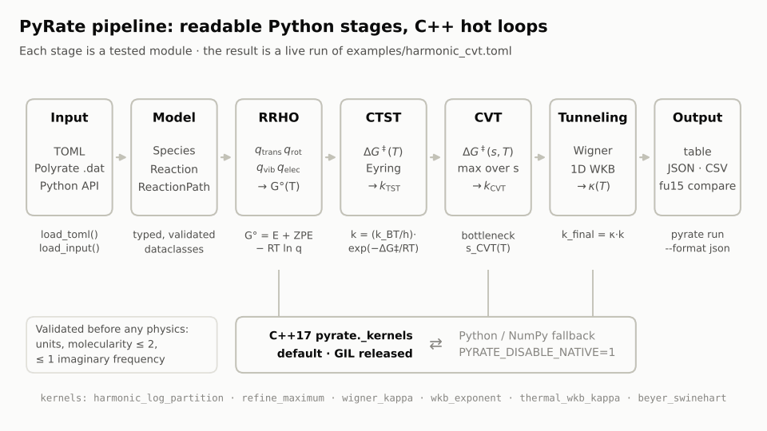
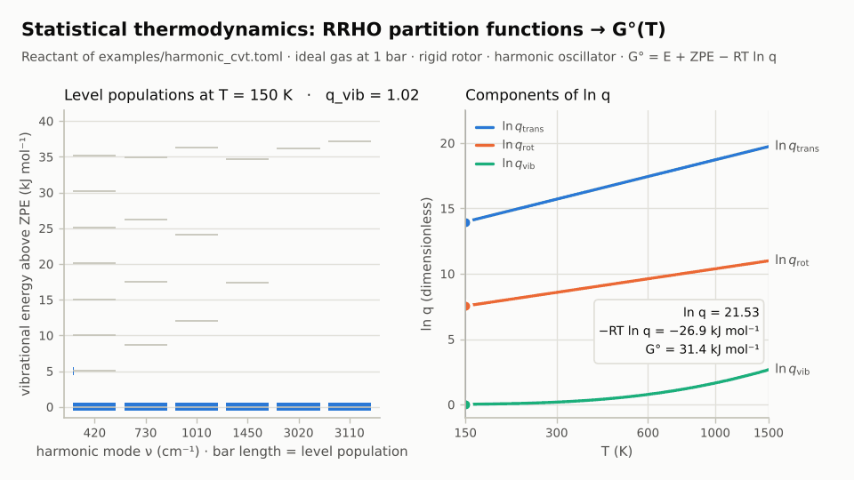
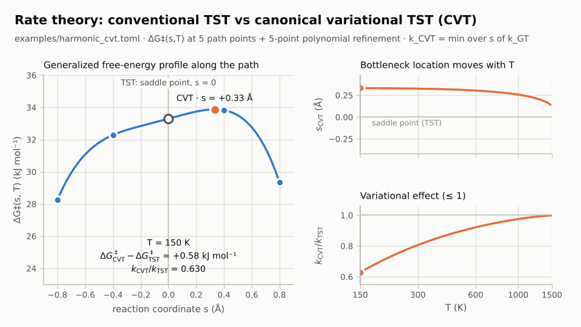
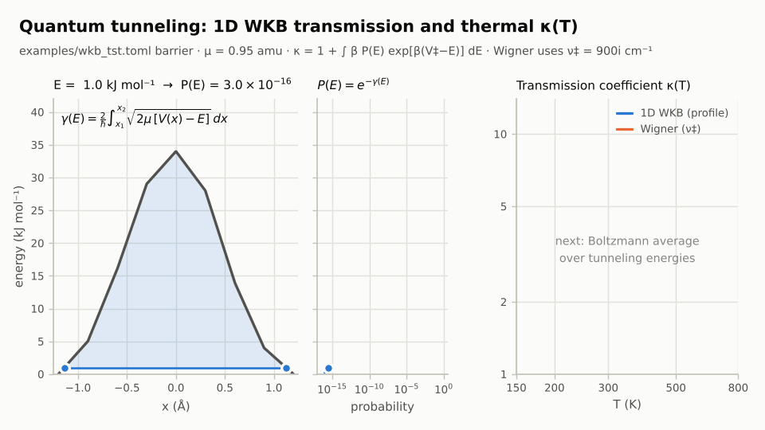
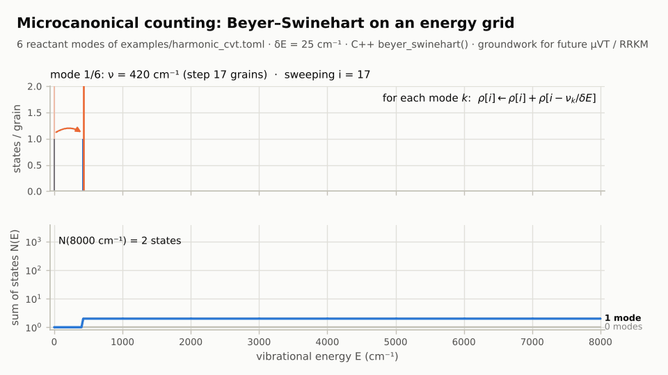
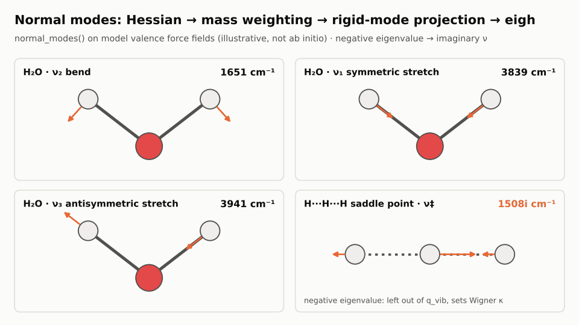
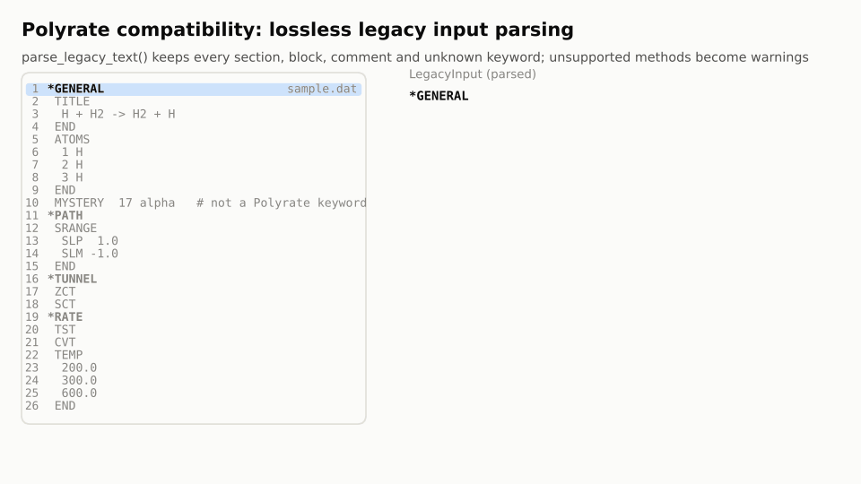
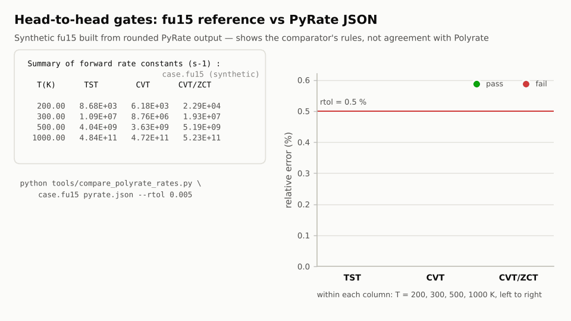
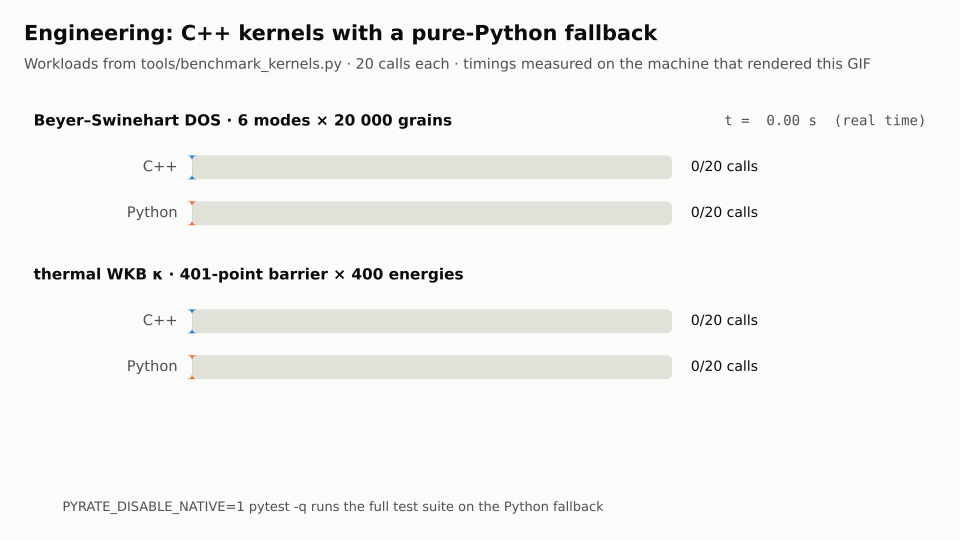

# PyRate

**PyRate** 是一个面向 Polyrate 工作流兼容性的反应速率程序：流程、输入模型与结果组织使用可读的 Python，分区函数批处理、变分极值、WKB 隧穿积分和状态计数等热点使用 C++。Python 后端提供逐函数回退，因此源码检出后即使尚未编译扩展也可以运行。

> 当前版本为 **0.1.0 / 核心阶段**。它已经是可安装、可运行、可测试的软件，但尚未宣称与 Polyrate 2023 全功能 1:1。精确边界见 [`docs/compatibility.md`](docs/compatibility.md)。

<p align="center">
  
</p>

一次计算依次经过 **输入 → 模型 → RRHO 分区函数 → CTST → CVT → 隧穿 → 输出**。分区函数、变分极值和隧穿积分这几处热点调用 C++ 内核，同样的函数也有 Python 实现可以替换。各部分原理见下文 [原理图解](#原理图解)。

## 已实现

- 理想气体标准态下的平动、刚性转子、谐振子与电子分区函数；
- 单分子和双分子常规过渡态理论（CTST/Eyring）；
- 沿反应路径最大化广义活化自由能的 canonical VTST/CVT；
- 最多五点的局部多项式瓶颈精修；
- Wigner 隧穿修正；
- 一维热 WKB / zero-curvature 风格透射修正；
- Beyer–Swinehart 振动态密度计数 C++ 内核；
- 笛卡尔 Hessian 质量加权、平移/转动投影和正规模分析；
- Polyrate `*GENERAL`、`*REACT1`、`*START`、`*PATH`、`*TUNNEL`、`*RATE` 等区段的保留式解析；
- Polyrate `fu15` 速率汇总表解析与数值误差比较；
- TOML 输入、命令行、JSON/CSV/表格输出、Python API 与 CI。

## 原理图解

本节动图都由 [`tools/make_readme_gifs.py`](tools/make_readme_gifs.py) 渲染，渲染时直接调用 PyRate 的公共 API 计算，每条曲线、每个数字都是程序算出来的，没有手绘。数据来自 `examples/` 里的两个算例；第 5 张图的模型力场和第 7 张图的合成 `fu15` 是例外，图中和正文都已注明。

| 方向 | 主要接口 |
|---|---|
| [1. 统计热力学：RRHO 分区函数](#1-统计热力学rrho-分区函数与标准-gibbs-能) | `pyrate.partition`、C++ `harmonic_log_partition` |
| [2. 速率理论：TST 与 CVT](#2-速率理论常规-tst-与正则变分-cvt) | `conventional_tst_rate_si`、`cvt_rate_si`、`refine_maximum` |
| [3. 量子隧穿：WKB 与 Wigner](#3-量子隧穿一维-wkb-与-wigner) | `pyrate.tunneling`、C++ `wkb_exponent` / `thermal_wkb_kappa` |
| [4. 微正则态计数](#4-微正则态计数beyerswinehart) | `vibrational_density_of_states`、C++ `beyer_swinehart` |
| [5. Hessian 正规模分析](#5-电子结构接口hessian-正规模分析) | `normal_modes` |
| [6. Polyrate legacy 输入](#6-polyrate-兼容legacy-输入的无损解析) | `pyrate inspect`、`parse_legacy_text` |
| [7. fu15 头对头比较](#7-头对头验证fu15-比较器的判定规则) | `tools/compare_polyrate_rates.py` |
| [8. C++ 内核与 Python 回退](#8-工程实现c-内核与-python-回退) | `pyrate native-info`、`PYRATE_DISABLE_NATIVE` |

### 1. 统计热力学：RRHO 分区函数与标准 Gibbs 能

<p align="center"></p>

左图是 `harmonic_cvt.toml` 中反应物 6 个谐振模式的能级，条长表示该能级的 Boltzmann 布居。温度升高时，低频模式的高能级先被热激发，`q_vib = ∏(1 − e^{−hcν/k_BT})⁻¹` 随之增大。右图是 `ln q` 的三个分量：平动项来自 1 bar 标准态体积，转动项来自刚性转子的转动惯量。三者合成标准 Gibbs 能 `G° = E + ZPE − RT ln q`，后面所有速率表达式都以它为输入。

### 2. 速率理论：常规 TST 与正则变分 CVT

<p align="center"></p>

常规 TST 固定在鞍点 `s = 0` 处计算 `ΔG‡`。CVT 则在每个温度下，沿反应路径找广义活化自由能 `ΔG‡(s,T)` 的最大值，这等价于取广义速率 `k_GT(s,T)` 的最小值。蓝色曲线是 `refine_maximum()` 在 5 个路径点上做的局部多项式拟合，脚本会检查它的极大值与程序给出的瓶颈一致。从图里可以看到两点：

- 瓶颈位置随温度连续移动；到约 1480 K，拟合曲线出现两个峰，全局最大值换到另一个峰上，瓶颈随之跳到鞍点的另一侧；
- 因为鞍点本身也是路径点之一，`k_CVT/k_TST ≤ 1` 始终成立。温度越低，变分效应越大。

### 3. 量子隧穿：一维 WKB 与 Wigner

<p align="center"></p>

动图分两段，使用 `wkb_tst.toml` 中的势垒：

1. **能量扫描**：阴影是能量 `E` 下的经典禁阻区。作用量 `γ(E) = (2/ħ)∫√(2μ[V(x) − E]) dx` 在两个转折点之间积分，透射概率 `P(E) = e^{−γ(E)}`。分段线性势垒上每一段都有解析积分；
2. **温度扫描**：`P(E)` 乘以 Boltzmann 因子后做 canonical 平均（中图绿线是热权重），得到 `κ(T) = 1 + ∫ β P(E) e^{β(V‡−E)} dE`，再与只依赖虚频的 Wigner 修正对比。低温下隧穿修正可达一个数量级，高温时趋近 1。

这是 zero-curvature 的一维计算单元，**不是** Polyrate 完整的 ZCT/SCT/LCT。

### 4. 微正则态计数：Beyer–Swinehart

<p align="center"></p>

对每个振动模式扫过能量网格，执行 `ρ[i] ← ρ[i] + ρ[i − ν/δE]`。上图是每个格点上的态数，下图是累计态数 `N(E)`：每加入一个模式，曲线整体抬高一截。动画里逐步重放的递推结果，与 C++ `beyer_swinehart()` 的输出逐格相同。这一步是今后 μVT/US、RRKM 与压力相关动力学的基础，这些功能尚未接入，见[兼容矩阵](docs/compatibility.md)。

### 5. 电子结构接口：Hessian 正规模分析

<p align="center"></p>

`normal_modes()` 先对笛卡尔 Hessian 做质量加权，再投影掉平动和转动，最后做对称本征分解；负本征值以负波数（虚频）返回。图中用的是 H₂O 和线性 H···H···H 鞍点的**模型价力场**，只作演示，不是从头算结果。可以看到 H₂O 的三个振动模式，以及鞍点唯一虚频所对应的、沿反应坐标的运动。虚频不进入 `q_vib`，但会用于 Wigner `κ`。

### 6. Polyrate 兼容：legacy 输入的无损解析

<p align="center"></p>

`parse_legacy_text()` 逐行识别 `*SECTION`、`TITLE … END` 这类 block 和普通关键字，右侧的树随解析进度逐项出现。未知关键字（例中的 `MYSTERY`）和注释都原样保留；输入里请求了尚未实现的方法（例中的 `SCT`）时会给出警告，不会静默地跑下去。命令行入口是 `pyrate inspect path/to/input.dat --json`。

### 7. 头对头验证：fu15 比较器的判定规则

<p align="center"></p>

比较器先按温度配对、换算到同一单位，再逐点计算相对误差。它只比较显式映射的列，默认是 `TST → k_tst` 和 `CVT → k_cvt`。未映射的列（如 `CVT/ZCT`）不会算作通过；加上 `--strict` 时，只要还有未映射的列，整次比较就判为失败。

> 图中的 `fu15` 是一个**合成文件**：把 PyRate 自己的结果舍入到三位有效数字生成，所以误差只来自舍入。它只用来展示判定规则，**不代表** PyRate 与 Polyrate 的数值一致。

### 8. 工程实现：C++ 内核与 Python 回退

<p align="center"></p>

用与 `tools/benchmark_kernels.py` 相同的工作负载，分别在 C++ 扩展和纯 Python 回退下各调用 20 次，进度条按实际耗时回放。图中的计时来自渲染这张 GIF 的机器，换一台机器数字会不同。在这两个负载上，两套后端的结果完全相同。设置 `PYRATE_DISABLE_NATIVE=1` 即可让整个测试集只用 Python 回退运行。

### 重新生成动图

```bash
python -m pip install -e ".[docs]"
```

```bash
python tools/make_readme_gifs.py
```

```bash
python tools/make_readme_gifs.py cvt tunneling
```

第三条只重绘列出的几张图，可用名称见 `python tools/make_readme_gifs.py --list`。脚本在 Python 3.10+ 下运行，依赖 matplotlib 和 Pillow，输出到 `docs/assets/`。

## 安装

需要 Python 3.10+、C++17 编译器和 NumPy。

```bash
git clone https://github.com/chen-yu-hao/PyRate.git
cd PyRate
python -m pip install -e ".[test]"
python -m pyrate native-info
pytest -q
```

安装时会构建 `pyrate._kernels`。调试纯 Python 回退时：

```bash
PYRATE_DISABLE_NATIVE=1 pytest -q
```

## 快速运行

```bash
pyrate validate examples/harmonic_cvt.toml
pyrate run examples/harmonic_cvt.toml
pyrate run examples/wkb_tst.toml --format json -o rates.json
```

示例输出包含每个温度的 `ΔG‡_TST`、`k_TST`、CVT 瓶颈坐标、`ΔG‡_CVT`、`k_CVT`、隧穿系数 `κ` 和最终速率。

### 检查旧 Polyrate 输入

```bash
pyrate inspect path/to/h3tr1.dat --json
pyrate validate path/to/h3tr1.dat
```

解析器会保留未知关键字，而不是静默删除。依赖外部势能面 hook、`fu30/fu31/fu40` 或尚未实现算法的旧输入目前只能检查，不能直接求解。

## Python API

```python
from pyrate import calculate_rates, load_toml

job = load_toml("examples/harmonic_cvt.toml")
result = calculate_rates(job.reaction, job.options, name=job.name)
for row in result.rows:
    print(row.temperature_k, row.k_final, row.rate_unit)
```

## 数值与单位约定

- 公开输入：能量 `kJ mol⁻¹`、频率 `cm⁻¹`、质量 `amu`、长度 `Å`；
- 内核：SI，每分子能量用于隧穿积分；
- 默认气相标准压力：`1 bar`；
- 单分子速率：`s⁻¹`；
- 双分子内部单位：`m³ mol⁻¹ s⁻¹`，可输出 `L mol⁻¹ s⁻¹` 或 `cm³ molecule⁻¹ s⁻¹`；
- `electronic_energy_kj_mol` 不含零点能；默认由正频率加入谐振零点能；
- 负频率不进入振动分区函数，过渡态最多允许一个负频率。

这些定义避免旧程序中原子单位、cgs 与 SI 混用造成的隐式换算。公式与 Polyrate 标准态处理的对应关系见 [`docs/architecture.md`](docs/architecture.md)。

## 项目结构

```text
src/pyrate/          Python 数据模型、解析、热力学、编排和 CLI
cpp/kernels.cpp      C++17 数值热点与 CPython 扩展
examples/            可直接运行的 TOML 样例
tests/               单元、原生后端和端到端测试
tools/               参考分发包导入、基准与 README 动图生成工具
docs/                架构、输入格式、兼容矩阵和验证方法
docs/assets/         README 原理动图（由 tools/make_readme_gifs.py 生成）
```

## 兼容性路线

当前核心覆盖 harmonic CTST/CVT、Wigner 与一维 WKB。以下 Polyrate 2023 能力仍需逐项移植并以官方测试输出验收：SCT/LCT、μVT/US、VRC-VTST、反应路径积分器、hindered rotor/非谐振动、双层校正、IVTST/ISPE/IOC、SS-QRRK 与压力依赖动力学。ICVT 已在 Polyrate 2023 中移除，仅作为旧版兼容性话题。

### Polyrate 官方输出逐列对照

在使用相同物理模型和温度网格生成 PyRate JSON 后，比较 Polyrate `fu15` 中实际可验证的速率列：

```bash
pyrate run examples/harmonic_cvt.toml --format json -o /tmp/pyrate.json
python tools/compare_polyrate_rates.py /path/to/case.fu15 /tmp/pyrate.json --rtol 0.005
```

工具将匹配温度、检查速率量纲、执行单位换算并输出每项误差；未映射的高级方法不会被误报为通过。该工具的合成测试通过**不代表**已经完成 112 个官方算例的数值验收，说明见 [头对头测试规范](docs/head-to-head.md)。

完整模块矩阵和“完成”的数值验收条件见 [`docs/compatibility.md`](docs/compatibility.md)。参考测试工作流见 [`docs/reference-validation.md`](docs/reference-validation.md)。

## 许可与来源

PyRate 使用 Apache License 2.0。Polyrate 2023 参考分发包的 DOI 为 `10.17632/vpf3y9cbhf.1`；本仓库不内置该分发包，测试导入工具接受用户本地的合法副本。具体归属见 [`NOTICE`](NOTICE)。
